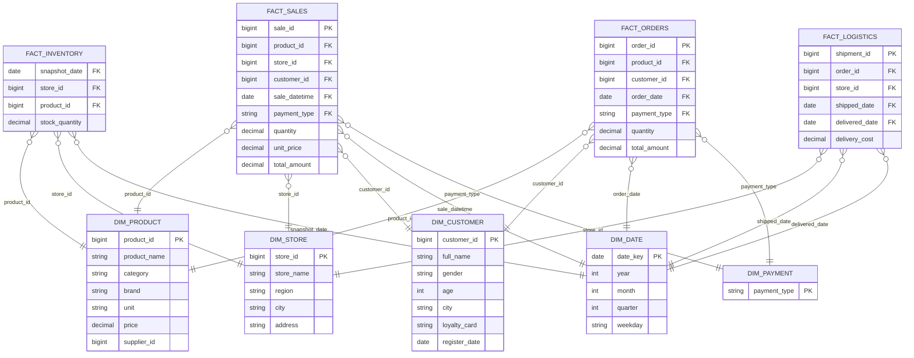

# Схема «звезда»

В модели четыре таблицы фактов. Каждая имеет собственный grain:
`fact_sales` — позиция в чеке, `fact_orders` — позиция заказа,
`fact_inventory` — остаток товара на дату, `fact_logistics` — отправка по
заказу. Дата остаётся измерением `dim_date`, а не отдельным фактом.

## Ключи и меры

| Таблица | Роль |
|---|---|
| `fact_sales` | продажи и меры `quantity`, `unit_price`, `total_amount` |
| `fact_orders` | заказы и заказанное количество |
| `fact_inventory` | ежедневные остатки товаров |
| `fact_logistics` | отправки, доставки и стоимость логистики |
| `dim_product` | товар, категория и бренд |
| `dim_store` | магазин, регион и город |
| `dim_customer` | клиент и программа лояльности |
| `dim_date` | календарные разрезы |
| `dim_payment` | способ оплаты |
